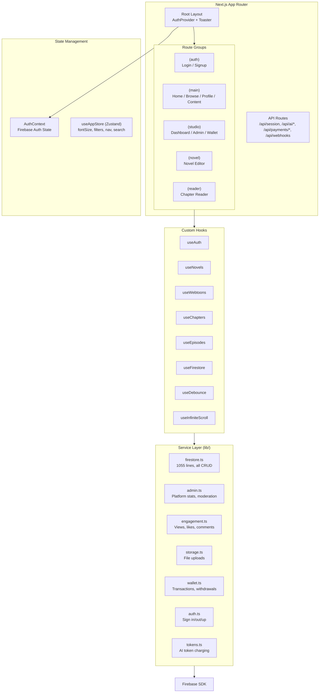
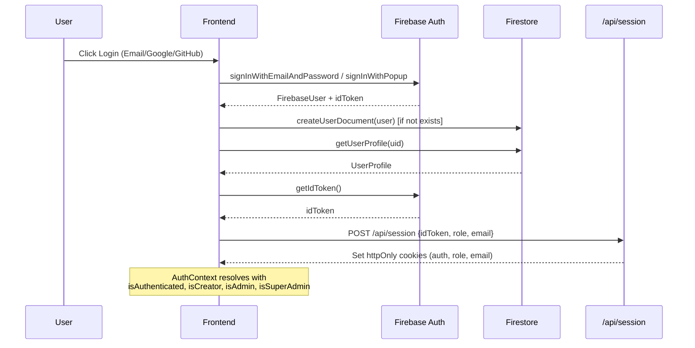
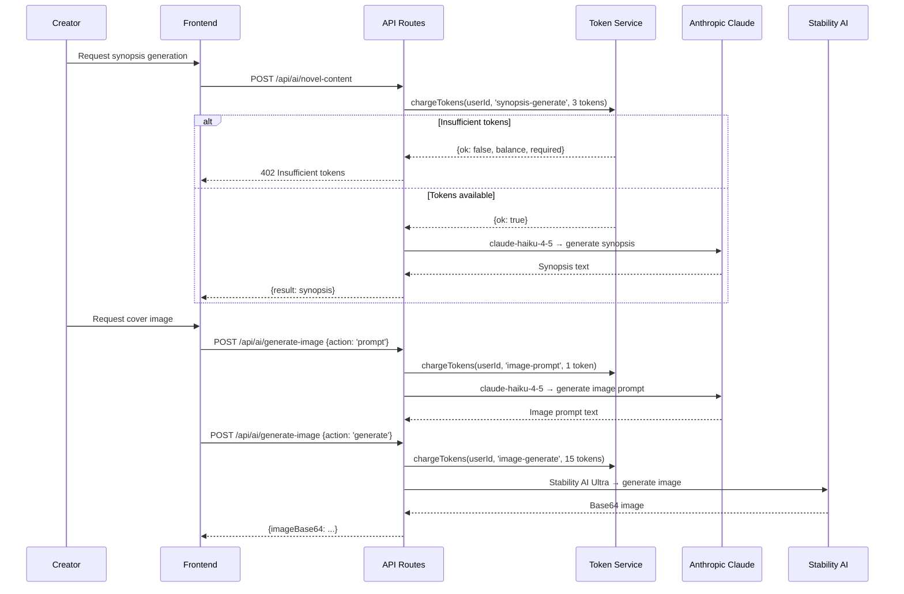
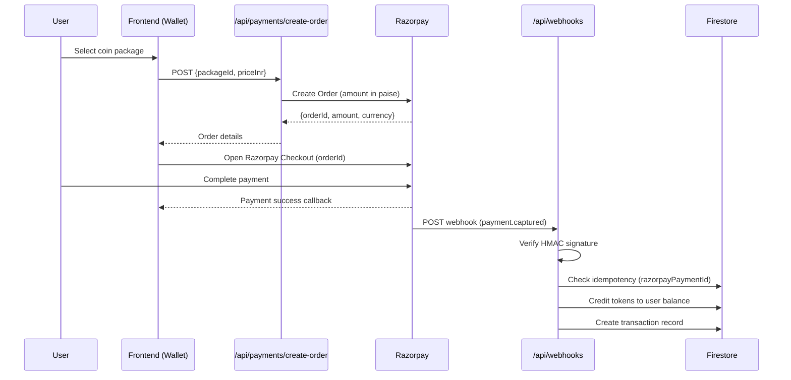
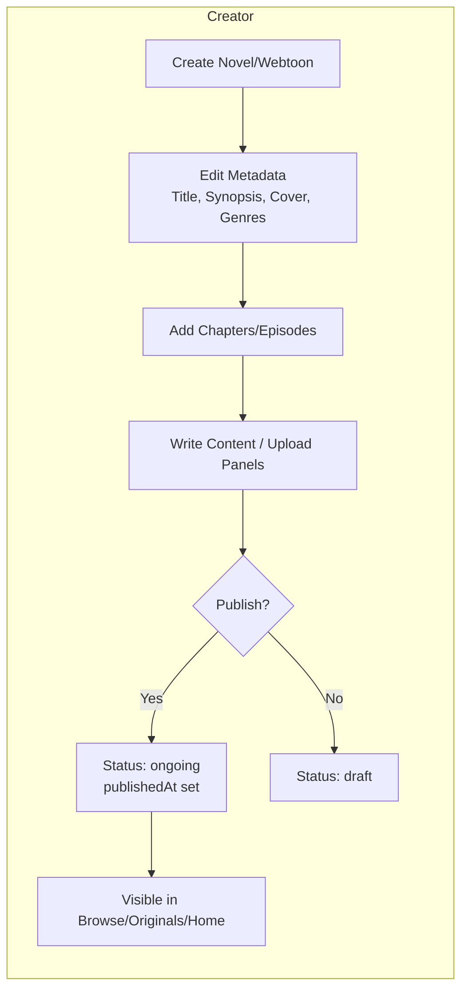
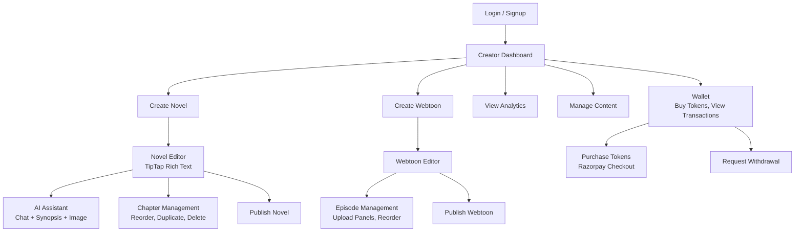
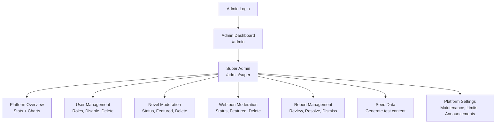

# Phase 2 — Software Architecture

## High-Level System Architecture

```mermaid
graph TB
    subgraph Users
        Reader["Reader"]
        Creator["Creator"]
        Admin["Admin/SuperAdmin"]
    end

    subgraph Frontend["Frontend — Next.js 16 App Router"]
        direction TB
        MainRoutes["(main) Public Pages"]
        AuthRoutes["(auth) Login/Signup"]
        StudioRoutes["(studio) Dashboard/Admin"]
        NovelRoutes["(novel) Novel Editor"]
        ReaderRoutes["(reader) Chapter Reader"]
        APIRoutes["API Routes (Server)"]
    end

    subgraph Services["Backend Services"]
        SessionAPI["Session API<br>/api/session"]
        AIAPI["AI API<br>/api/ai/*"]
        PaymentAPI["Payment API<br>/api/payments/*"]
        WebhookAPI["Webhook API<br>/api/webhooks"]
    end

    subgraph External["External Services"]
        Anthropic["Anthropic Claude<br>Story AI"]
        StabilityAI["Stability AI<br>Image Generation"]
        Razorpay["Razorpay<br>Payment Gateway"]
    end

    subgraph Firebase["Firebase"]
        FirebaseAuth["Firebase Auth<br>Email + Google + GitHub"]
        Firestore["Cloud Firestore<br>NoSQL Database"]
        FirebaseStorage["Firebase Storage<br>Image Uploads"]
    end

    subgraph Deployment["Deployment"]
        Vercel["Vercel<br>Next.js Hosting"]
    end

    Reader --> MainRoutes
    Reader --> ReaderRoutes
    Creator --> StudioRoutes
    Creator --> NovelRoutes
    Admin --> StudioRoutes

    MainRoutes --> Firestore
    AuthRoutes --> FirebaseAuth
    StudioRoutes --> Firestore
    NovelRoutes --> Firestore
    ReaderRoutes --> Firestore

    SessionAPI --> FirebaseAuth
    AIAPI --> Anthropic
    AIAPI --> StabilityAI
    PaymentAPI --> Razorpay
    WebhookAPI --> Razorpay
    WebhookAPI --> Firestore

    Frontend --> Vercel
```

---

## Frontend Architecture

---

## Database Architecture (Firestore Collections)

```mermaid
erDiagram
    USERS ||--o{ NOVELS : "creates"
    USERS ||--o{ WEBTOONS : "creates"
    USERS ||--o{ COMMENTS : "writes"
    USERS ||--o{ BOOKMARKS : "bookmarks"
    USERS ||--o{ READING_HISTORY : "reads"
    USERS ||--o{ FOLLOWS : "follows"
    USERS ||--o{ TRANSACTIONS : "has"
    USERS ||--o{ WITHDRAWALS : "requests"
    USERS ||--o{ LIKES : "likes"
    USERS ||--o{ REPORTS : "reports"

    NOVELS ||--o{ CHAPTERS : "contains"
    WEBTOONS ||--o{ EPISODES : "contains"

    COMMENTS ||--o{ COMMENTS : "replies to"

    USERS {
        string uid PK
        string email
        string displayName
        string photoURL
        string bannerURL
        string role "user|creator|admin|superadmin"
        boolean isCreator
        string bio
        object socialLinks
        number followerCount
        number followingCount
        number totalViews
        number totalEarnings
        number balance
        timestamp createdAt
        timestamp updatedAt
    }

    NOVELS {
        string id PK
        string authorId FK
        string authorName
        string title
        string slug
        string synopsis
        string coverURL
        string bannerURL
        string status "draft|published|ongoing|completed|hiatus"
        string visibility "public|private"
        array genres
        array tags
        boolean isPremium
        boolean isFeatured
        boolean isOriginal
        number viewCount
        number likeCount
        number bookmarkCount
        number chapterCount
        number rating
        number ratingCount
        timestamp createdAt
        timestamp updatedAt
        timestamp publishedAt
    }

    CHAPTERS {
        string id PK
        string novelId FK
        string title
        number chapterNumber
        string content
        number wordCount
        boolean isPremium
        number coinCost
        number viewCount
        string status "draft|published"
        timestamp createdAt
        timestamp publishedAt
    }

    WEBTOONS {
        string id PK
        string authorId FK
        string authorName
        string title
        string slug
        string synopsis
        string coverURL
        string status "draft|published|ongoing|completed|hiatus"
        string visibility "public|unlisted|private"
        array genres
        array tags
        boolean isPremium
        boolean isFeatured
        boolean isOriginal
        number viewCount
        number likeCount
        number bookmarkCount
        number episodeCount
        number rating
        number ratingCount
        timestamp createdAt
        timestamp updatedAt
        timestamp publishedAt
    }

    EPISODES {
        string id PK
        string webtoonId FK
        string title
        number episodeNumber
        array panels
        string thumbnailURL
        boolean isPremium
        number coinCost
        number viewCount
        string status "draft|published"
        timestamp createdAt
        timestamp publishedAt
    }

    COMMENTS {
        string id PK
        string targetId FK
        string targetType "novel|webtoon|chapter|episode"
        string authorId FK
        string authorName
        string content
        number likeCount
        boolean isEdited
        string parentId "nullable for replies"
        timestamp createdAt
        timestamp updatedAt
    }

    BOOKMARKS {
        string id PK
        string contentId FK
        string contentType "novel|webtoon"
        timestamp addedAt
    }

    READING_HISTORY {
        string id PK
        string contentId FK
        string contentType "novel|webtoon"
        string lastChapterId
        number lastChapterNumber
        timestamp lastRead
    }

    FOLLOWS {
        string id PK "followerId_followingId"
        string followerId FK
        string followingId FK
        timestamp createdAt
    }

    LIKES {
        string id PK "uid_contentType_contentId"
        string uid FK
        string contentType
        string contentId
        string parentId
        timestamp createdAt
    }

    TRANSACTIONS {
        string id PK
        string userId FK
        string type "coin_purchase|ai_usage|chapter_unlock|..."
        number amount
        number coins
        string description
        string relatedContentId
        string razorpayPaymentId
        timestamp createdAt
    }

    WITHDRAWALS {
        string id PK
        string creatorId FK
        number amount
        string method "upi|bank_transfer|paypal|wise"
        object accountDetails
        string status "pending|approved|processing|completed|rejected"
        timestamp createdAt
        timestamp processedAt
    }

    VIEWS {
        string id PK "viewerId_contentId_date"
        string viewerId
        string contentId
        string contentType
        string parentId
        string date
        timestamp createdAt
    }

    REPORTS {
        string id PK
        string targetId FK
        string targetType "novel|webtoon|comment|user"
        string reporterId FK
        string reason
        string details
        string status "pending|reviewed|resolved|dismissed"
        timestamp createdAt
    }

    AUDIT_LOGS {
        string id PK
        string adminUid FK
        string adminEmail
        string action
        string resource
        string resourceId
        string details
        timestamp createdAt
    }

    SETTINGS {
        string id PK "platform"
        boolean maintenanceMode
        string maintenanceMessage
        boolean allowNewSignups
        boolean allowContentCreation
        number maxUploadSizeMB
        number aiGenerationsPerDay
        string announcementBanner
        boolean announcementVisible
        string defaultUserRole
    }

    NOVEL_AI_CHATS {
        string novelId PK
        subcollection messages
    }
```

---

## Authentication Flow

---

## AI Generation Pipeline

---

## Payment Flow

---

## Publishing Flow

---

## Creator Workflow

---

## Admin Workflow

