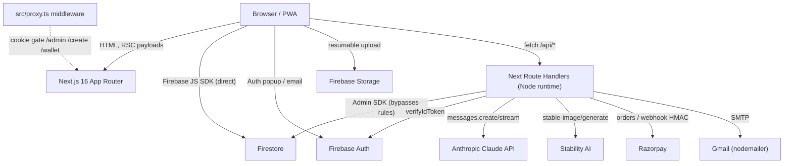
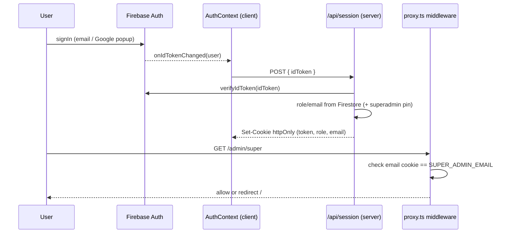
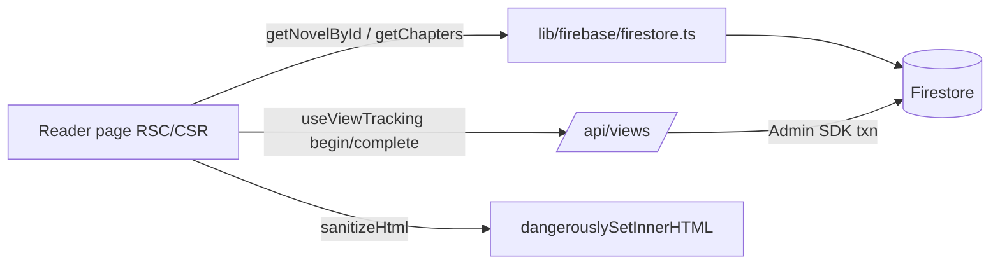

# Toonflow Studio Paint — Comprehensive Technical Documentation

> Generated from a direct inspection of the codebase (not assumptions). Every technology below is backed by a file-path reference. Where a dependency is installed but never imported, it is called out explicitly.
>
> Scope inspected: `package.json`, `package-lock.json`, `tsconfig.json`, `next.config.js`, `eslint.config.mjs`, `tailwind.config.ts`, `postcss.config.js`, `firebase.json`, `.firebaserc`, `firestore.rules`, `firestore.indexes.json`, `storage.rules`, `.env.example`, `src/proxy.ts` (middleware), all 11 API routes, the full `src/` tree (166 TS/TSX files), `public/` (PWA), and existing `docs/`.

> **⚙️ Remediation status (2026-07-10):** the actionable cleanup items below were applied — unused deps removed, dead GitHub-auth code deleted, `getUserTransactions` de-duplicated, a shared timestamp util extracted, AI prompts moved to `lib/ai/prompts.ts`, `measurementId` dropped, mono font fixed, Vitest + 26 unit tests added, Prettier/EditorConfig added, and a GitHub Actions CI workflow added. Two latent bugs (`slugify`, `readingTime`) were fixed. Still **deferred**: automated *coverage* beyond pure logic, Redis rate limiter, CSP nonce, precomputed analytics, Sentry, SWR migration, and the `firestore.ts` god-module split. See `.claude/CHANGES.md` for details.

---

## 1. Project Overview

### What it does
**Toonflow Studio Paint** is a professional **webtoon / manga / web-novel SaaS platform**. It combines:
- A **public reading experience** — browse, discover, read novels (rich-text chapters) and webtoons (vertical panel strips), with likes, ratings, comments, bookmarks, follows.
- A **Creator Studio** — write novels in a TipTap rich editor, build webtoon episodes by uploading panels, with an **AI Story Assistant** (Anthropic Claude) and **AI cover/banner generation** (Stability AI).
- A **token / monetization economy** — coin packages purchased via **Razorpay**, tokens spent on AI features, creator earnings-per-view, and withdrawal requests.
- **Analytics** — a tamper-proof server-side view-tracking pipeline feeding creator and super-admin analytics dashboards.
- **Admin & Super-admin** consoles — moderation, user management, platform settings, business analytics.

### Architecture overview
Single **Next.js 16 App Router** application (monolith, not a monorepo). It is a **full-stack Next app**: the frontend (React Server + Client Components) and the backend (Route Handlers under `src/app/api/`) live in one deployable. **Firebase** is the backing platform (Auth + Firestore + Storage). There is no separate API server.



**Two data-access planes** (deliberate):
1. **Client plane** — the browser talks to Firestore/Storage directly via the Firebase JS SDK, constrained by `firestore.rules` / `storage.rules`.
2. **Server plane** — Route Handlers use the **Firebase Admin SDK** (`src/lib/firebase/serverApp.ts`), which *bypasses* security rules, for anything that must be tamper-proof: view counting, token balances, payment crediting, analytics aggregation, support requests.

### Monorepo or single project
**Single project.** No workspaces, no `packages/`, no Turborepo/Nx/Lerna. One `package.json`.

### Folder structure

```
d:\toonflow
├── src
│   ├── app/                      # App Router — routes, layouts, API
│   │   ├── (auth)/               # login / signup (centered, no nav)
│   │   ├── (main)/               # public site (Navbar + Footer + MobileNav)
│   │   ├── (novel)/              # creator novel/webtoon editors
│   │   ├── (reader)/             # immersive chapter reader
│   │   ├── (studio)/             # dashboard, wallet, admin, super-admin
│   │   ├── api/                  # 11 Route Handlers (Node runtime)
│   │   ├── layout.tsx            # root layout (fonts, providers, PWA, toaster)
│   │   ├── robots.ts, sitemap.ts # SEO
│   │   └── globals.css
│   ├── components/               # PascalCase, grouped by domain
│   │   ├── ui/ admin/ auth/ content/ dashboard/ editor/ home/
│   │   ├── layout/ novel/ pwa/ reader/ revenue/ social/ support/ webtoon/
│   ├── contexts/AuthContext.tsx  # single React context (auth)
│   ├── hooks/                    # 11 use* hooks (data + UX)
│   ├── lib/
│   │   ├── firebase/             # config, db, admin(client svc), serverApp(admin sdk), auth, firestore, storage, engagement, wallet
│   │   ├── views/                # server-side view-tracking pipeline
│   │   ├── revenue/config.ts     # single source of truth for money rates
│   │   ├── auth/serverUser.ts    # verifiedUid()
│   │   ├── api/guard.ts          # bodyTooLarge / escapeHtml
│   │   ├── tokens.ts             # server-only token accounting (Admin SDK)
│   │   └── utils/                # cn, constants, formatters, sanitizeHtml, url, time, requestCache
│   ├── store/useAppStore.ts      # Zustand (persist)
│   ├── types/                    # user, novel, webtoon, comment, transaction, analytics
│   └── proxy.ts                  # middleware (named `proxy`, NOT middleware.ts)
├── public/                       # sw.js, manifest.json, icons, images, og-image
├── docs/                         # 8 pre-existing internal docs (this file adds a 9th)
├── firestore.rules, storage.rules, firestore.indexes.json, firebase.json, .firebaserc
├── next.config.js, tailwind.config.ts, postcss.config.js, eslint.config.mjs, tsconfig.json
└── SECURITY.md, CLAUDE.md, AGENTS.md, README.md
```

### Major modules
| Module | Location | Responsibility |
|---|---|---|
| Auth | `contexts/AuthContext.tsx`, `lib/firebase/auth.ts`, `api/session` | Firebase auth + verified session cookies |
| Reading | `app/(main)`, `app/(reader)` | browse / discover / read |
| Creator Studio | `app/(novel)`, `components/editor` | novel & webtoon authoring |
| AI | `api/ai/*`, `components/editor/AIAssistant.tsx`, `components/novel/AIImageGenerator.tsx` | Claude assist + Stability images |
| Monetization | `lib/tokens.ts`, `api/payments`, `api/webhooks`, `lib/revenue/config.ts`, `app/(studio)/wallet` | tokens, Razorpay, earnings |
| View tracking / analytics | `lib/views/*`, `api/views*`, `api/creator/analytics`, `api/admin/analytics` | tamper-proof views → dashboards |
| Admin | `app/(studio)/admin`, `lib/firebase/admin.ts` | moderation & platform ops |
| PWA | `public/sw.js`, `components/pwa/PwaRegister.tsx` | offline shell |

---

## 2. Frontend

| Concern | Technology | Version (package.json) | Evidence |
|---|---|---|---|
| Framework | **Next.js** (App Router, `src/` dir, `@/*` alias) | `16.2.9` | `package.json`, `next.config.js`, `src/app/` |
| UI runtime | **React** / React DOM | `19.2.4` | `package.json` |
| Language | **TypeScript** strict | `^5` | `tsconfig.json` (`"strict": true`) |
| Styling | **Tailwind CSS v3** + PostCSS + Autoprefixer | `3.4.19` | `tailwind.config.ts`, `postcss.config.js` |
| State (global) | **Zustand** + persist | `5.0.14` | `src/store/useAppStore.ts` |
| State (server cache) | Module-scope promise cache | — | `src/lib/utils/requestCache.ts` |
| Forms | **react-hook-form** | `7.80.0` | `components/auth/*Form.tsx` |
| Validation | **Zod** + `@hookform/resolvers` | `4.4.3` / `5.4.0` | client forms + every API route |
| Animation | **Framer Motion** | `12.41.0` | 5 files (see below) |
| Icons | **lucide-react** | `1.21.0` | app-wide |
| Charts | **Recharts** | `3.9.0` | analytics dashboards |
| Rich text | **TipTap** (+7 extensions) | `3.27.1` | `components/editor/NovelRichEditor.tsx` |
| Drag & drop | **@dnd-kit** (core/sortable/utilities) | `6.3.1` / `10.0.0` / `3.2.2` | chapter/episode sidebars |
| Toasts | **react-hot-toast** | `2.6.0` | `app/layout.tsx` + app-wide |
| Dates | **date-fns** | `4.4.0` | `lib/utils/formatters.ts` only |
| PDF export | **jsPDF** | `4.2.1` | `app/(novel)/create/novel/[novelId]/page.tsx` (dynamic import) |
| Class merge | **clsx** + **tailwind-merge** | `2.1.1` / `3.6.0` | `lib/utils/cn.ts` |
| UI primitives | **Radix UI** (7 packages installed) | 1.x–2.x | see radix breakdown |

### JavaScript usage
Effectively none authored — the app is TypeScript end to end. `tsconfig.json` has `"allowJs": true`, but the only hand-written `.js` files are configuration (`next.config.js`, `postcss.config.js`) and the hand-rolled service worker `public/sw.js` (necessarily plain JS, runs in the SW global scope).

### TypeScript configuration (`tsconfig.json`)
`target ES2017`, `module esnext`, `moduleResolution bundler`, `strict: true`, `noEmit: true`, `isolatedModules`, `jsx: react-jsx`, `incremental`, path alias `@/* → ./src/*`, Next TS plugin enabled.

### State management
- **Zustand** `useAppStore` — UI/prefs only: `fontSize`, `browseFilters`, `mobileNavOpen`, `searchQuery`, `loginModalOpen`. `persist` middleware writes `fontSize` + `browseFilters` to `localStorage` key `toonflow-prefs` via `partialize`.
- **React Context** — a single `AuthContext` (`src/contexts/AuthContext.tsx`) holds auth state and derived role booleans. No Redux/Jotai/Recoil.
- **Firestore realtime** — `onSnapshot` subscriptions (`subscribeToNovels/Chapters/Webtoons/Episodes`) drive live editor lists via hooks like `useNovels`.

### UI libraries — Radix breakdown
Installed: `react-avatar, react-dialog, react-dropdown-menu, react-scroll-area, react-select, react-tabs, react-tooltip`.

| Radix package | Used? | Where |
|---|---|---|
| react-dropdown-menu | ✅ | `EditorToolbar.tsx`, `UserMenu.tsx`, `MobileNav.tsx` |
| react-avatar | ✅ | `UserMenu.tsx`, `MobileNav.tsx` |
| react-tooltip | ✅ | `components/ui/Tooltip.tsx` (shared provider) |
| react-dialog | ✅ | `components/ui/Modal.tsx` |
| **react-scroll-area** | ❌ | **not imported anywhere** |
| **react-select** | ❌ | **not imported anywhere** |
| **react-tabs** | ❌ | **not imported anywhere** |

### CSS framework & styling approach
Tailwind **v3.4.19** (the project explicitly forbids v4 syntax — see `CLAUDE.md`). Design tokens defined in `tailwind.config.ts`: a dark palette (`bg`, `text`, `accent`, `danger/warning/success`), custom keyframe animations (`fade-in`, `slide-up`, `shimmer`, `scale-in`), `maxWidth.editor: 900px`, and one plugin: **`tailwind-scrollbar`** (`nocompatible`). Global styles + the `.tiptap` and `.skip-to-main` classes live in `src/app/globals.css`. Conditional classes always go through `cn()` (clsx + tailwind-merge).

### Routing
Next App Router with **five route groups**: `(auth)`, `(main)`, `(novel)`, `(reader)`, `(studio)`. Dynamic segments: `novel/[id]`, `webtoon/[id]/episode/[episodeId]`, `profile/[uid]`, `create/novel/[novelId]`, `create/webtoon/[webtoonId]`, `novel/[id]/chapter/[chapterId]`. Each group has its own `layout.tsx`, `loading.tsx`, `error.tsx`.

### Forms & validation
`react-hook-form` powers `LoginForm.tsx` / `SignupForm.tsx`. `zod` is the validation layer — used both for client resolvers (`@hookform/resolvers`) and, more importantly, as the **server-side request schema** in every AI/view API route (`bodySchema.safeParse(...)`).

### Animation / Icons / Charts
- **Framer Motion** — `dashboard/page.tsx`, `SupportModal.tsx`, `ConfirmDialog.tsx`, `revenue/WhereMoneyGoes.tsx`, `ui/AnimatedNumber.tsx`.
- **lucide-react** — the sole icon set (note: no brand icons; see support flow memo).
- **Recharts** — `AdminCharts.tsx`, `BusinessCharts.tsx`, `CreatorCharts.tsx`, `CreatorAnalyticsSection.tsx`, `dashboard/page.tsx`.

### Markdown / Rich text / Drag & drop
- **Markdown**: none — no markdown renderer library is installed. Reader content is HTML, sanitized by `lib/utils/sanitizeHtml.ts`.
- **Rich text**: **TipTap** with StarterKit + placeholder, character-count, text-align, text-style, color, underline extensions (`NovelRichEditor.tsx`). AI chapter output is emitted as `<p>` HTML.
- **Drag & drop**: **@dnd-kit** in `ChapterSidebar.tsx` and `EpisodeSidebar.tsx` for reordering (persisted via `reorderChapters` / `reorderEpisodes`).

### Image optimization / Fonts / Theme / i18n / a11y
- **Images**: `next/image` with AVIF+WebP, `minimumCacheTTL: 3600`, `remotePatterns` allowlisting Firebase Storage, Google, GitHub avatars, picsum (`next.config.js`).
- **Fonts**: `next/font/google` **Inter** (self-hosted via `--font-inter` CSS variable, `display: swap`). JetBrains Mono referenced in the Tailwind `fontFamily.mono` but not loaded via `next/font` (falls back to system mono).
- **Theme**: dark-only. `<html className="dark …">` is hard-coded in `app/layout.tsx`; there is no theme switcher (Zustand only stores `fontSize`).
- **i18n**: none. No `next-intl`/`i18next`; content `language` defaults to `'en'`.
- **Accessibility**: no dedicated a11y *library*, but a rigorous hand-rolled WCAG discipline is codified in `CLAUDE.md` and visible throughout (skip-link in `layout.tsx`, `aria-label` on icon buttons, `role="toolbar"`, `aria-live`, focus-visible rings).

---

## 3. Backend

### Framework & API architecture
The backend is **Next.js Route Handlers** (App Router `route.ts` files) — a **REST-ish RPC** style (mostly `POST` with a `{ action, ... }` or `{ phase, ... }` body; `GET` for analytics reads). All 11 routes pin `export const runtime = 'nodejs'` (needed for `firebase-admin` and Node `crypto`). No Express/Fastify/NestJS; no GraphQL; no tRPC.

### Route structure (11 endpoints)
| Route | Methods | Purpose |
|---|---|---|
| `/api/session` | POST, DELETE | mint/clear verified session cookies |
| `/api/ai/novel-content` | POST | synopsis generate/improve/expand (Claude Haiku) |
| `/api/ai/novel-assist` | POST | story assistant chat + full-chapter write (Claude Sonnet/Opus, streaming) |
| `/api/ai/generate-image` | POST | prompt (Claude) + image (Stability AI) |
| `/api/payments/create-order` | POST | create Razorpay order for a coin package |
| `/api/webhooks` | POST | Razorpay `payment.captured` → credit tokens |
| `/api/support` | POST | support request → Firestore + Gmail auto-reply |
| `/api/views` | POST | two-phase view tracking (begin/complete) |
| `/api/views/stats` | GET | per-content view analytics (owner/admin) |
| `/api/creator/analytics` | GET | 90-day creator analytics |
| `/api/admin/analytics` | GET | 14-day business analytics (super-admin) |

### Authentication (server side)
Every privileged route verifies the Firebase **ID token from an httpOnly cookie** using the Admin SDK. The canonical helper is `verifiedUid(req)` (`src/lib/auth/serverUser.ts`) — "the uid MUST come from the verified token, never from the request body." Analytics routes re-verify inline and additionally check ownership/role.

### Authorization
- **Middleware gate** (`src/proxy.ts`): cookie-based route protection (see §5).
- **Route-level**: `/api/admin/analytics` requires `decoded.email === SUPER_ADMIN_EMAIL`; `/api/views/stats` requires content owner or `role ∈ {admin, superadmin}`.
- **Data-level**: `firestore.rules` / `storage.rules` (see §9).

### Middleware
`src/proxy.ts` exports a function named **`proxy`** (project convention — a real `middleware.ts` is explicitly forbidden to avoid a conflict). `matcher` scopes it to `/create/**`, `/dashboard/**`, `/admin/**`, `/wallet/**`.

### Validation & error handling
- **Zod** schemas validate AI + view bodies; failures return `400 Invalid request` (no field-level leakage).
- **Size guard**: `bodyTooLarge()` (`lib/api/guard.ts`) rejects oversized payloads with `413` before buffering (per-route caps: 16KB support, 64KB AI, 512KB novel-assist).
- Errors are logged server-side (`console.error`) and returned generically (`502`/`503`/`500`) so upstream internals (API keys, model errors) never reach the client.

### Logging
`console.*` only, with bracketed tags (`[/api/webhooks]`, `[views]`, `[Support]`). No Sentry/Datadog/pino. `@opentelemetry/api` is a dependency but **not imported** anywhere in `src`.

### Background jobs
None (no cron, queues, or Cloud Functions). "Aggregation" is done inline on each analytics request. The in-memory rate limiter self-sweeps opportunistically.

### File uploads
Client-side **resumable uploads** to Firebase Storage (`lib/firebase/storage.ts`, `uploadBytesResumable`) with progress callbacks; paths are per-owner (`users/{uid}/avatar`, `novels/{id}/cover`, `webtoons/{id}/episodes/{epId}/panel_N`). Enforcement (type/size/owner) is in `storage.rules`, not the API.

### Rate limiting
In-memory sliding-window limiter with temporary blocking (`lib/views/rateLimit.ts`), configured in `lib/views/config.ts` and reused by `/api/support` (8/10min per IP). **Caveat**: per-instance memory — noted in-code as needing Redis/Upstash for multi-instance production.

### Email
**nodemailer** over Gmail SMTP (`service: 'gmail'`) sends support auto-replies (`/api/support`), gated on `GMAIL_APP_PASSWORD`. User-supplied name is `escapeHtml()`-escaped before HTML interpolation.

### Payments
**Razorpay** via REST (no SDK): `/api/payments/create-order` calls `POST api.razorpay.com/v1/orders` with Basic auth; `/api/webhooks` verifies the `x-razorpay-signature` HMAC-SHA256 with `crypto.timingSafeEqual` and credits coins idempotently.

### Caching
`Cache-Control: private, max-age=30–60` on analytics responses; `immutable` on static assets (§10); client-side `requestCache` dedupe; SW runtime caches.

---

## 4. Database

### Database & ORM
**Cloud Firestore** (Firebase, project `toonflow-studio-paint-f384c`). **No ORM** — direct Firestore SDK calls, wrapped by a hand-written service layer (`src/lib/firebase/firestore.ts`, ~1120 lines). Client reads/writes use the JS SDK; privileged writes use the Admin SDK.

### Collections (schema)
Top-level collections + subcollections observed across `firestore.rules` and the service layer:

| Collection | Subcollections | Notes |
|---|---|---|
| `users/{uid}` | `followers/{followerId}`, `following/{targetId}` | profile + server-managed `balance`, `role`, `isCreator`, `totalEarnings`, counters |
| `novels/{id}` | `chapters/{chapterId}` | public read; `viewCount` server-only |
| `webtoons/{id}` | `episodes/{episodeId}` | panels array on episode |
| `comments/{id}` | — | flat, `parentId` for replies; body ≤ 5000 chars (rule-enforced) |
| `likes/{uid_type_id}` | — | 1 doc per like |
| `ratings/{uid_type_id}` | — | value 1–5, aggregate kept on content doc |
| `follows/{follower_following}` | — | flat edge (+ the user subcollections) |
| `bookmarks/{uid}/items/{id}` | — | owner-only |
| `readingHistory/{uid}/items/{id}` | — | owner-only |
| `transactions/{id}` | — | **server-write only** |
| `withdrawals/{id}` | — | creator create (pending), admin approve |
| `supportRequests/{id}` | — | Admin-SDK create only |
| `reports/{id}` | — | moderation |
| `viewDedup`, `chapterViews`, `viewStats/{k}/daily/{day}`, `suspiciousViews` | — | **server-only** view pipeline |
| `creatorAnalytics`, `revenueHistory`, `viewHistory` | — | reserved, server-only (rules deny all) |
| `novel_ai_chats/{novelId}/messages` | — | AI chat history |
| `auditLogs`, `settings/{platform}` | — | admin |

### Indexes
`firestore.indexes.json` defines **6 composite indexes** — 4 on `chapterViews` (`chapterId+viewedAt`, `parentId+viewedAt`, `hashedIp+viewedAt`, `userId+viewedAt`) and 2 on `supportRequests` (`email+createdAt`, `status+createdAt`). The service layer deliberately **avoids most composite indexes** by using single-field `where` + client-side filter/sort (see `browseContent`, `searchContent`, `getTrending*`).

### Relationships
Denormalized (NoSQL): `authorName`/`authorPhotoURL` are copied onto content docs; `syncAuthorContent()` fans a profile rename out to all authored novels/webtoons in batched writes (≤400/batch). Counters (`chapterCount`, `followerCount`, etc.) are maintained with `increment()`.

### Query patterns
Prefix search via title range (`>= q` / `< q+1`); "trending" = fetch `limit×4` then sort by `viewCount` client-side; `in` queries chunked to ≤30 ids (analytics).

### Migrations
No migration framework. Schema evolves via **backfill-on-read** — `createUserDocument()` patches missing `role`/`isCreator`/`createdAt` on existing docs; sorting tolerates legacy docs missing `createdAt`.

### Transactions
`runTransaction` used for: token spend (`lib/tokens.ts`), Razorpay credit + idempotency (`/api/webhooks`), atomic view recording (`lib/views/viewService.ts`), ratings aggregate (`engagement.ts`), and the follow/unfollow triple-write (`firestore.ts`). Batched writes (`writeBatch`) for deletes/reorders.

---

## 5. Authentication

| Aspect | Implementation |
|---|---|
| Provider | **Firebase Auth** (`lib/firebase/config.ts`, `lib/firebase/auth.ts`) |
| Login methods | Email/password, **Google** (popup) |
| OAuth | Google (`GoogleAuthProvider`, `prompt: select_account`). **GitHub** provider is coded (`signInWithGithub`) but **not wired to any UI** — dead code (LoginForm/SignupForm only call `signInWithGoogle`). |
| Session | **Verified httpOnly session cookies**: `AuthContext` sends the ID token to `POST /api/session`; the server `verifyIdToken`s it and sets `toonflow-auth-token`, `toonflow-user-role`, `toonflow-user-email` (httpOnly, `sameSite=lax`, `secure` in prod, 7-day). Role/email are derived **server-side** from the token + Firestore, never trusted from the body. Refreshed on every `onIdTokenChanged`. |
| Client state | `AuthContext` exposes `isAuthenticated / isCreator / isAdmin / isSuperAdmin` + `refreshProfile()`. Firestore SDK is **lazy-imported** so signed-out visitors don't pay for it. |
| Protected routes | `src/proxy.ts`: `/admin/super/**` → `email === SUPER_ADMIN_EMAIL`; `/admin/**` → `role ∈ {admin, superadmin}`; `/create/**`,`/dashboard/**`,`/wallet/**` → any auth cookie. `/create/webtoon` additionally gated by `FEATURE_FLAGS.webtoonStudio`. |
| Roles | `user \| creator \| admin \| superadmin` (`types/user.ts`, `constants.ts`). Super-admin hard-pinned to `shashwathbc@gmail.com`. |
| Permissions | Enforced in three layers: middleware (routes), route handlers (analytics), Firestore/Storage rules (data). |
| Password storage | Handled entirely by Firebase Auth — the app never sees/stores passwords. |
| Clerk / Auth.js | **Not used.** |



---

## 6. Cloud Services

| Service | Used? | Integration | Evidence |
|---|---|---|---|
| **Firebase Auth** | ✅ | client SDK + Admin verify | `lib/firebase/config.ts`, `auth.ts`, `serverApp.ts` |
| **Firestore** | ✅ | client SDK + Admin SDK | `lib/firebase/db.ts`, `firestore.ts`, `serverApp.ts` |
| **Firebase Storage** | ✅ | resumable uploads | `lib/firebase/storage.ts`, `storage.rules` |
| **Anthropic Claude** | ✅ | `@anthropic-ai/sdk` | `api/ai/*` |
| **Stability AI** | ✅ | REST `stable-image/generate/ultra` | `api/ai/generate-image` |
| **Razorpay** | ✅ | REST orders + webhook HMAC | `api/payments/create-order`, `api/webhooks` |
| **Gmail (SMTP)** | ✅ | nodemailer | `api/support` |
| **Google Sign-In** | ✅ | Firebase `GoogleAuthProvider` | `lib/firebase/auth.ts` |
| Supabase / AWS / MongoDB Atlas / Twilio / SendGrid / Resend / OpenAI / Gemini / Cloudflare | ❌ | not present | — |
| Vercel | ⚠️ | not configured in-repo; README is the CNA default; likely deploy target but no `vercel.json` | — |
| Analytics (GA etc.) | ⚠️ | `NEXT_PUBLIC_FIREBASE_MEASUREMENT_ID` env exists but **Firebase Analytics is never initialized** in code | `config.ts` (measurementId passed but `getAnalytics` never called) |

---

## 7. APIs

### Internal APIs
All 11 Route Handlers are documented in §3. Key contracts:
- **`/api/views`** — two-phase: `{phase:'begin'}` returns a signed HMAC view token + sets signed visitor cookie; `{phase:'complete'}` validates token, server-measured dwell, scroll, bot signals, rate limits, then records the view. Rejections return `200 {counted:false}` (no oracle).
- **`/api/ai/novel-assist`** — `mode: 'chat' | 'write-chapter'`; write-chapter uses `client.messages.stream()` server-side with `maxDuration = 300`.
- **`/api/webhooks`** — Razorpay `payment.captured`; coins derived from the trusted `COIN_PACKAGES` catalog, not the payment amount; idempotent via `transactions/rzp_{paymentId}`.

### External APIs called
- `api.anthropic.com` (via SDK) — models: `claude-haiku-4-5-20251001` (synopsis/image-prompt), `claude-sonnet-4-6` (chat), `claude-opus-4-8` (write-chapter).
- `api.stability.ai/v2beta/stable-image/generate/ultra` — WebP, aspect `2:3` (cover) / `16:9` (banner), returns base64.
- `api.razorpay.com/v1/orders` + inbound webhook.
- Gmail SMTP.
- Firebase (googleapis/firebaseio/firestore/identitytoolkit endpoints).

### REST / GraphQL / WebSockets / Realtime
- **REST**: the internal API + Razorpay/Stability.
- **GraphQL**: none.
- **WebSockets**: none directly; Firestore `onSnapshot` uses Firebase's realtime channel (`wss://*.firebaseio.com` is in the CSP `connect-src`).

---

## 8. Storage

| Kind | Used for | Evidence |
|---|---|---|
| **Firestore** | primary datastore (all app data) | §4 |
| **Firebase Storage** | avatars, banners, novel/webtoon covers, episode panels | `lib/firebase/storage.ts` |
| **localStorage** | Zustand persisted prefs (`toonflow-prefs`); per-content view guard (`tf_viewed_*`) | `store/useAppStore.ts`, `hooks/useViewTracking.ts` |
| **sessionStorage** | anonymous view session id (`tf_session_id`) | `hooks/useViewTracking.ts` |
| **Cookies** | `toonflow-auth-token/role/email` (httpOnly session); `tf_vid` (signed visitor id) | `api/session`, `api/views` |
| **Cache Storage (SW)** | `tf-static-v1` (cache-first), `tf-pages-v1` (network-first offline fallback) | `public/sw.js` |
| **IndexedDB** | only Firebase Auth's internal persistence (not used directly) | — |

---

## 9. Security

**This project has an unusually strong, deliberate security posture** (see `SECURITY.md`, 15KB). Highlights:

### CSP & secure headers (`next.config.js`)
Full Content-Security-Policy applied to all routes: `default-src 'self'`, scoped `script-src`/`connect-src`/`img-src`/`frame-src` allowlists (Razorpay, Google, Firebase), `object-src 'none'`, `base-uri 'self'`, `form-action 'self'`, `frame-ancestors 'none'`, `upgrade-insecure-requests`. Plus **HSTS** (2yr preload), `X-Frame-Options: DENY`, `X-Content-Type-Options: nosniff`, `Referrer-Policy`, `COOP: same-origin-allow-popups`, restrictive `Permissions-Policy`, `X-Powered-By` stripped. *Known trade-off documented in-file:* `script-src` keeps `'unsafe-inline'` (App Router inline bootstrap); a nonce upgrade path is described.

### XSS
Allowlist HTML **sanitizer** (`lib/utils/sanitizeHtml.ts`) for all reader content rendered via `dangerouslySetInnerHTML` — DOM-parse allowlist in the browser (drops unknown tags, `on*` handlers, unsafe URLs/styles, forces `rel=noopener`), conservative regex strip on the server. `escapeHtml()` for email templates. Storage rules **exclude `image/svg+xml`** (scripted-image vector).

### CSRF
`isSameOrigin()` on `/api/views` (Origin/Referer host check); session cookies `sameSite=lax`; Razorpay webhook authenticated by HMAC signature, not cookies.

### SQL injection
N/A (NoSQL, no query string concatenation).

### Firebase security rules
Detailed, least-privilege `firestore.rules` + `storage.rules`. Money/role/counter fields (`balance`, `role`, `isCreator`, `viewCount`, `totalEarnings`) are **server-managed only** — clients literally cannot write them; the `onlyUpdates()` helper permits readers to bump `likeCount`/`rating` but nothing else; follower counts bounded to ±1; comment bodies length-capped; `transactions` client-create denied entirely.

### Secrets / env / CORS
All secrets are server-only env vars (`ANTHROPIC_API_KEY`, `STABILITY_API_KEY`, `RAZORPAY_*`, `FIREBASE_PRIVATE_KEY`, `GMAIL_APP_PASSWORD`, `VIEW_TOKEN_SECRET`); only `NEXT_PUBLIC_*` reach the client (Firebase web config is safe to expose). `.env.local` git-ignored. No permissive CORS (same-origin API).

### View-tracking integrity
HMAC-signed tokens + visitor cookies (`lib/views/crypto.ts`), server-clock dwell measurement (client cannot fake "20s on page"), bot heuristics, hashed IP/UA in logs, replay/stale-token rejection.

### Concerns / notes
1. **Rate limiter is in-memory** — bypassable across multiple server instances; needs Redis for horizontal scale (acknowledged in code).
2. `'unsafe-inline'` in `script-src` (documented trade-off; nonce upgrade pending).
3. Password reset/`sendUserPasswordReset` and some admin flows run through the **client** Admin service (`lib/firebase/admin.ts`) — these are gated by `isAdmin()` in rules but run with the caller's client credentials, so correctness depends on rules, not server verification.

---

## 10. Performance

| Technique | Where |
|---|---|
| **Server Components by default** | data-fetching pages; `'use client'` only where needed (hooks/events) |
| **Bundle isolation** | Firestore SDK split out of the root bundle: `db.ts`/`storage.ts` separate from `config.ts`; `AuthContext` **lazy-imports** `firestore.ts` so signed-out users don't load it |
| **Dynamic imports** | `jsPDF` imported on demand (`create/novel/[novelId]`); `firestoreService()` dynamic import in AuthContext |
| **Image optimization** | `next/image`, AVIF/WebP, remote allowlist, 1yr immutable cache on `/icons`,`/images`,`/og-image` |
| **Font optimization** | `next/font` Inter, `display: swap`, self-hosted variable |
| **Request de-dupe / cache** | `lib/utils/requestCache.ts` promise cache; realtime `onSnapshot` avoids re-fetch |
| **Atomic counters** | `FieldValue.increment` everywhere (no read-modify-write races) |
| **Streaming** | `/api/ai/novel-assist` streams the model server-side (`messages.stream`) with `maxDuration=300` |
| **Turbopack** | dev **and** build run on Turbopack (webpack fully removed; no `next-pwa`) |
| **PWA runtime caching** | `public/sw.js` cache-first statics, network-first pages |
| **Suspense/loading** | per-route-group `loading.tsx` skeletons |
| Memoization | light; `<Skeleton>` for content loading per convention |

---

## 11. Build System

| Tool | Value |
|---|---|
| Bundler / compiler | **Turbopack** (`next dev` + `next build`); SWC transpile via Next |
| Package manager | **npm** (`package-lock.json` present; no pnpm/yarn lock) |
| Scripts | `dev`, `build`, `start`, `lint` (`package.json`) — minimal |
| Linting | **ESLint 9** flat config extending `eslint-config-next` core-web-vitals + typescript (`eslint.config.mjs`) |
| Formatting | **No Prettier config** in-repo (formatting is convention-driven) |
| Git hooks | **None** — no Husky/lint-staged/commitlint |
| CSS build | PostCSS + Tailwind + Autoprefixer (`postcss.config.js`) |

---

## 12. Dev Tools

| Tool | Present? |
|---|---|
| ESLint | ✅ `eslint.config.mjs` (flat, Next presets) |
| Prettier | ❌ no config |
| Husky / lint-staged | ❌ |
| Commitlint | ❌ |
| EditorConfig | ❌ |
| VSCode settings | ❌ (no `.vscode/`) |
| webhint | ✅ `.hintrc` (extends `development`, ignores one inline-style hint in `ChapterSidebar.tsx`) |
| Project conventions | `CLAUDE.md`, `AGENTS.md` (agent/coding rules), `SECURITY.md`, `docs/` (8 internal docs) |

---

## 13. Testing

**There is no automated testing in this project.**
- No Jest, Vitest, Playwright, Cypress, or React Testing Library installed.
- No `*.test.*` / `*.spec.*` files anywhere in `src`.
- No `test` script in `package.json`.
- **Coverage: 0%.**

This is the single biggest gap in the codebase (see §21).

---

## 14. Environment Variables

From `.env.example` and code usage. **No secret values are shown.**

| Variable | Purpose | Used In | Required |
|---|---|---|---|
| `NEXT_PUBLIC_FIREBASE_API_KEY` | Firebase web config | `lib/firebase/config.ts` | ✅ |
| `NEXT_PUBLIC_FIREBASE_AUTH_DOMAIN` | Firebase auth domain | `config.ts` | ✅ |
| `NEXT_PUBLIC_FIREBASE_PROJECT_ID` | Firebase project | `config.ts` | ✅ |
| `NEXT_PUBLIC_FIREBASE_STORAGE_BUCKET` | Storage bucket | `config.ts` | ✅ |
| `NEXT_PUBLIC_FIREBASE_MESSAGING_SENDER_ID` | FCM sender | `config.ts` | ✅ |
| `NEXT_PUBLIC_FIREBASE_APP_ID` | Firebase app id | `config.ts` | ✅ |
| `NEXT_PUBLIC_FIREBASE_MEASUREMENT_ID` | Analytics id (declared, **unused in code**) | `config.ts` | ⬜ optional |
| `NEXT_PUBLIC_APP_URL` | canonical URL (metadata, constants) | `layout.tsx`, `constants.ts` | ⬜ (has fallback) |
| `NEXT_PUBLIC_APP_NAME` | app name | — | ⬜ |
| `FIREBASE_PROJECT_ID` | Admin SDK | `lib/firebase/serverApp.ts`(admin) | ✅ server |
| `FIREBASE_CLIENT_EMAIL` | Admin SDK | admin | ✅ server |
| `FIREBASE_PRIVATE_KEY` | Admin SDK (PEM, `\n`-escaped) | admin | ✅ server |
| `VIEW_TOKEN_SECRET` | HMAC secret for view tokens/cookies | `lib/views/crypto.ts` | ⬜ (falls back to hash of private key) |
| `ANTHROPIC_API_KEY` | Claude | `api/ai/*` | ✅ for AI |
| `STABILITY_API_KEY` | image gen | `api/ai/generate-image` | ⬜ (feature degrades to 503) |
| `RAZORPAY_KEY_ID` / `RAZORPAY_KEY_SECRET` | create orders | `api/payments/create-order` | ✅ for payments |
| `RAZORPAY_WEBHOOK_SECRET` | verify webhook HMAC | `api/webhooks` | ✅ for payments |
| `NEXT_PUBLIC_RAZORPAY_KEY_ID` | checkout.js public key | client checkout | ✅ for payments |
| `GMAIL_USER` | support sender | `api/support` | ⬜ (defaults to support addr) |
| `GMAIL_APP_PASSWORD` | Gmail SMTP auth | `api/support` | ⬜ (auto-reply skipped if absent) |

---

## 15. Dependencies

**Runtime dependencies (26):**

| Library | Version | Purpose | Used in | Removable? |
|---|---|---|---|---|
| next | 16.2.9 | framework | everywhere | core |
| react / react-dom | 19.2.4 | UI runtime | everywhere | core |
| firebase | 12.15.0 | client Auth/DB/Storage | `lib/firebase/*` | core |
| firebase-admin | 14.1.0 | server Admin SDK | `serverApp.ts`, API routes | core |
| @anthropic-ai/sdk | 0.105.0 | Claude AI | `api/ai/*` | core (AI) |
| zod | 4.4.3 | validation | forms + API routes | core |
| react-hook-form | 7.80.0 | forms | auth forms | ✅ used |
| @hookform/resolvers | 5.4.0 | zod↔RHF | auth forms | ✅ used |
| zustand | 5.0.14 | global state | `store/useAppStore.ts` | ✅ used |
| framer-motion | 12.41.0 | animation | 5 files | ✅ used |
| recharts | 3.9.0 | charts | 5 analytics files | ✅ used |
| lucide-react | 1.21.0 | icons | app-wide | ✅ used |
| react-hot-toast | 2.6.0 | toasts | `layout.tsx` + app | ✅ used |
| @tiptap/react | 3.27.1 | rich editor | `NovelRichEditor.tsx` | ✅ used |
| @tiptap/starter-kit | 3.27.1 | editor core | editor | ✅ used |
| @tiptap/extension-placeholder | 3.27.1 | editor | editor | ✅ used |
| @tiptap/extension-character-count | 3.27.1 | word count | editor | ✅ used |
| @tiptap/extension-text-align | 3.27.1 | alignment | editor | ✅ used |
| @tiptap/extension-text-style | 3.27.1 | color base | editor | ✅ used |
| @tiptap/extension-color | 3.27.1 | text color | editor | ✅ used |
| @tiptap/extension-underline | 3.27.1 | underline | editor (imported in toolbar) | ✅ used |
| @dnd-kit/core | 6.3.1 | drag & drop | chapter/episode sidebars | ✅ used |
| @dnd-kit/sortable | 10.0.0 | sortable | sidebars | ✅ used |
| @dnd-kit/utilities | 3.2.2 | dnd utils | sidebars | ✅ used |
| @radix-ui/react-dialog | 1.1.17 | modal | `ui/Modal.tsx` | ✅ used |
| @radix-ui/react-dropdown-menu | 2.1.18 | menus | toolbar/menus | ✅ used |
| @radix-ui/react-avatar | 1.2.0 | avatar | user menus | ✅ used |
| @radix-ui/react-tooltip | 1.2.10 | tooltips | `ui/Tooltip.tsx` | ✅ used |
| @radix-ui/react-scroll-area | 1.2.12 | — | **none** | ⚠️ **remove** |
| @radix-ui/react-select | 2.3.1 | — | **none** | ⚠️ **remove** |
| @radix-ui/react-tabs | 1.1.15 | — | **none** | ⚠️ **remove** |
| nodemailer | 9.0.3 | support email | `api/support` | ✅ used |
| jspdf | 4.2.1 | PDF export | novel editor (dynamic) | ✅ used |
| date-fns | 4.4.0 | relative time | `formatters.ts` (1 fn) | ✅ used (minor) |
| clsx | 2.1.1 | class join | `cn.ts` | ✅ used |
| tailwind-merge | 3.6.0 | class merge | `cn.ts` | ✅ used |
| @opentelemetry/api | 1.9.1 | tracing API | **not imported** | ⚠️ **likely remove** |

**Dev dependencies (12):** `typescript ^5`, `@types/*` (node/react/react-dom/nodemailer), `eslint ^9`, `eslint-config-next 16.2.9`, `tailwindcss 3.4.19`, `tailwind-scrollbar 3.1.0`, `autoprefixer 10.4.21`, `postcss 8.5.4` — all used.

**Findings:**
- **Unused (safe to remove):** `@radix-ui/react-scroll-area`, `@radix-ui/react-select`, `@radix-ui/react-tabs`, `@opentelemetry/api` (verify Next.js instrumentation doesn't need it first).
- **Dead code:** `signInWithGithub` + `GithubAuthProvider` in `lib/firebase/auth.ts` (never called from UI).
- **Duplicates:** none. `clsx` + `tailwind-merge` are complementary, not duplicate.
- **Deprecated:** none detected.
- **Outdated:** all on current majors (Next 16, React 19, Tailwind 3.4, Zod 4). `@anthropic-ai/sdk 0.105` moves fast — check for a newer minor.

---

## 16. Project Architecture

### Data flow (read a chapter)


### State flow
Zustand (UI prefs, persisted) + AuthContext (auth) + Firestore `onSnapshot` (live creator lists) + `requestCache` (dedupe). No global server-state library (React Query/SWR absent — hand-rolled).

### Request lifecycle (privileged API)
`middleware (proxy.ts) → route handler → verifiedUid() (Admin verify cookie) → zod validate → bodyTooLarge → business logic (Admin SDK txn) → generic JSON response`.

### Authentication flow
See §5 diagram.

### Deployment flow
Not defined in-repo (no CI/CD, no Dockerfile, no `vercel.json`). Firebase side deploys via `firebase deploy` (rules/indexes/storage) targeting project `toonflow-studio-paint-f384c` (`.firebaserc`, `firebase.json`). App hosting target is unspecified in-repo (README is the default create-next-app Vercel blurb).

### Component hierarchy (root)
`RootLayout → PwaRegister + AuthProvider → TooltipProvider → {route-group layout → page} + Toaster`.

---

## 17. Code Quality

### Dead code / unused
- `signInWithGithub` / `GithubAuthProvider` — defined, never called.
- Radix `scroll-area`, `select`, `tabs` — installed, never imported.
- `@opentelemetry/api` — never imported.
- `NEXT_PUBLIC_FIREBASE_MEASUREMENT_ID` — passed to Firebase config but `getAnalytics()` is never invoked.
- Two `getUserTransactions` implementations exist (`lib/firebase/firestore.ts` and `lib/firebase/wallet.ts`) — **duplicate logic** with slightly different limits/sorting.

### Large files (code smell: God module)
- `src/lib/firebase/firestore.ts` — **~1120 lines**, one flat module handling users, novels, chapters, webtoons, episodes, bookmarks, history, comments, browse, search, follows, transactions, withdrawals, AI chat, realtime listeners. Prime candidate to split by domain.
- `src/lib/firebase/admin.ts` — ~350 lines (client-side admin service; note the confusing name vs `serverApp.ts` which is the actual Admin SDK).

### Naming hazards
- `lib/firebase/admin.ts` = **client** admin dashboard service (uses the web SDK); `lib/firebase/serverApp.ts` = **Admin SDK**. Easy to confuse — a comment or rename would help.
- `src/proxy.ts` (not `middleware.ts`) is intentional but non-obvious.

### Duplicate code
- Timestamp-to-seconds helpers re-implemented inline in ~6 places (`admin.ts`, `firestore.ts`, `wallet.ts`, `engagement.ts`) — should be one util.
- Analytics day-bucketing (`dayKey`, viewer keying, per-day maps) duplicated between `api/creator/analytics` and `api/admin/analytics`.

### Circular dependencies
None obvious; the `config → db/storage` split is deliberately acyclic.

### Unused hooks/components/assets
No obvious unused React components detected in the sampled tree; `useFollow`, `useInfiniteScroll`, `useDebounce`, `useFirestore` all have call sites. Assets in `public/` are all referenced (icons via manifest, `ravana-cover.png`, `og-image.png`).

---

## 18. Deployment

| Aspect | Status |
|---|---|
| Hosting platform | **Not declared in-repo.** Config (Turbopack build, security headers, `next/image`) is Vercel-friendly; README is the default Vercel template text. No `vercel.json`. |
| CI/CD | **None** (no `.github/workflows`, no other CI config). |
| Build pipeline | `next build` (Turbopack) → `next start`. |
| Deployment scripts | Firebase: `firebase deploy` for rules/indexes/storage (project pinned in `.firebaserc`). App deploy scripts absent. |
| Domains / SSL | Canonical domain `toonflowstudiopaint.com` (constants/metadata); SSL/CDN provided by the (unstated) host. |
| CDN | Static assets marked `immutable` for edge caching; relies on host CDN. |
| Containers | No Dockerfile / docker-compose. |

---

## 19. AI & Automation

| Aspect | Detail |
|---|---|
| SDK | **`@anthropic-ai/sdk` 0.105.0** (`api/ai/*`) |
| Model providers | **Anthropic Claude** (text) + **Stability AI** (images) |
| Models | `claude-haiku-4-5-20251001` (synopsis, image-prompt), `claude-sonnet-4-6` (assistant chat), `claude-opus-4-8` (full-chapter write) |
| Streaming | Yes — `client.messages.stream()` for write-chapter (`api/ai/novel-assist`), `maxDuration=300` |
| Prompt storage | **Inline in route files** as constants (`SYSTEM_PROMPT`, `WRITE_CHAPTER_PROMPT`) — not externalized |
| Token metering | Custom (`lib/tokens.ts`): `TOKEN_COSTS` per action, atomic Admin-SDK transaction decrements `balance` + writes an `ai_usage` transaction; charged against the **verified uid** only |
| Chat history | Persisted in Firestore `novel_ai_chats/{novelId}/messages` |
| Image gen | Stability `stable-image/generate/ultra`, WebP, returns base64 (`imageBase64`) |
| Embeddings / vector DB | **None** |
| Agents / MCP | **None** |
| Consistency engine | Prior-chapter excerpts injected into the context block to maintain continuity (custom, not RAG) |

---

## 20. Complete Tech Stack Summary

| Category | Technology | Version | Purpose |
|---|---|---|---|
| Frontend framework | Next.js (App Router) | 16.2.9 | full-stack React |
| UI runtime | React / React DOM | 19.2.4 | components |
| Language | TypeScript (strict) | ^5 | type safety |
| Styling | Tailwind CSS v3 + PostCSS + Autoprefixer | 3.4.19 | design system (dark) |
| UI primitives | Radix UI (dialog, dropdown, avatar, tooltip) | 1.x–2.x | accessible primitives |
| State | Zustand (persist) + React Context | 5.0.14 | prefs + auth |
| Forms/validation | react-hook-form + zod + resolvers | 7.80 / 4.4.3 / 5.4 | forms + server validation |
| Rich text | TipTap (+7 ext) | 3.27.1 | novel editor |
| Drag & drop | @dnd-kit | 6.3.1 | reorder chapters/episodes |
| Charts | Recharts | 3.9.0 | analytics dashboards |
| Animation | Framer Motion | 12.41.0 | motion |
| Icons | lucide-react | 1.21.0 | iconography |
| Toasts | react-hot-toast | 2.6.0 | notifications |
| PDF | jsPDF | 4.2.1 | export novel to PDF |
| Dates | date-fns | 4.4.0 | relative time |
| Backend | Next Route Handlers (Node runtime) | — | REST/RPC API |
| Auth | Firebase Auth + verified session cookies | 12.15.0 | Google + email |
| Database | Cloud Firestore | (Firebase 12) | app data (NoSQL) |
| Server DB access | firebase-admin | 14.1.0 | tamper-proof writes |
| Storage | Firebase Storage | (Firebase 12) | images/panels |
| Email | nodemailer (Gmail SMTP) | 9.0.3 | support auto-reply |
| Payments | Razorpay (REST + webhook) | — | coin purchases |
| AI (text) | Anthropic Claude via SDK | 0.105.0 | story assistant |
| AI (image) | Stability AI (REST) | — | covers/banners |
| Security | CSP + HSTS + rules + HMAC + sanitizer | — | defense-in-depth |
| Build | Turbopack (dev+build) | (Next 16) | bundling |
| Lint | ESLint 9 (next presets) | ^9 | linting |
| PWA | hand-rolled sw.js + manifest | — | offline shell |
| Package manager | npm | — | deps |
| Testing | — | — | **none** |
| Analytics | custom view pipeline + Recharts | — | first-party analytics |
| Infrastructure | Firebase project + (unstated app host) | — | hosting |

---

## 21. Improvement Suggestions (ranked by impact)

### 🔴 High Impact
1. **Add automated testing.** Zero tests today. Start with Vitest + RTL for the security-critical pure logic (`lib/views/crypto.ts`, `lib/tokens.ts`, `sanitizeHtml.ts`, `revenue/config.ts`) and Playwright smoke tests for auth + reader + checkout. This is the biggest risk for a money-handling platform.
2. **Externalize the rate limiter (Redis/Upstash).** The in-memory limiter (`lib/views/rateLimit.ts`) is per-instance — under horizontal scaling, view-count fraud and support spam limits are trivially bypassed. Also add distributed rate limiting to AI/payment routes.
3. **Add CI/CD.** No pipeline exists. A GitHub Actions workflow (typecheck + lint + build + test + `firebase deploy --only firestore:rules`) would catch regressions and prevent rules from drifting from code.
4. **Split the `firestore.ts` god-module** (~1120 lines) into domain files (`users.ts`, `content.ts`, `social.ts`, `commerce.ts`). Improves tree-shaking, testability, and merge-conflict surface.

### 🟡 Medium Impact
5. **Remove dead weight:** uninstall unused `@radix-ui/react-{scroll-area,select,tabs}` and `@opentelemetry/api`; delete `signInWithGithub`/`GithubAuthProvider` or wire it into the UI; either initialize Firebase Analytics or drop `MEASUREMENT_ID`.
6. **De-duplicate logic:** one `getUserTransactions`, one timestamp util, shared analytics day-bucketing between the two analytics routes.
7. **Rename for clarity:** `lib/firebase/admin.ts` (client) vs `serverApp.ts` (Admin SDK) is a footgun — rename to `adminClientService.ts` / `adminSdk.ts`.
8. **CSP nonce upgrade** to drop `'unsafe-inline'` from `script-src` (path already documented in `SECURITY.md`) — meaningfully hardens against XSS.
9. **Consider precomputed analytics.** Both analytics routes scan up to 20,000 `chapterViews` docs per request; at scale this is slow/costly. Move to scheduled aggregation (Cloud Function/cron) writing `viewStats` rollups, and have dashboards read those.

### 🟢 Low Impact
10. **Adopt SWR/React Query** to replace the hand-rolled `requestCache` for consistent caching, revalidation, and error/loading ergonomics.
11. **Add Prettier + a pre-commit hook** (Husky + lint-staged) to enforce the (currently convention-only) formatting.
12. **Move AI prompts to a `prompts/` module** for versioning and easier iteration/A-B testing.
13. **Add error monitoring** (Sentry) — currently only `console.error`; production errors are invisible.
14. **Load JetBrains Mono via `next/font`** or remove it from the Tailwind `fontFamily.mono` (currently declared but never loaded).

---

### Appendix — Inventory counts
- App routes/pages: ~30 page files across 5 route groups.
- API endpoints: **11** route handlers (all Node runtime).
- React components: ~70 under `src/components/`.
- Custom hooks: **11** (`src/hooks/`).
- Firestore collections: ~22 (incl. subcollections & server-only).
- Composite indexes: **6**.
- Runtime dependencies: **~35** (incl. TipTap/dnd-kit/Radix sub-packages); dev: **12**.
- Test files: **0**.
